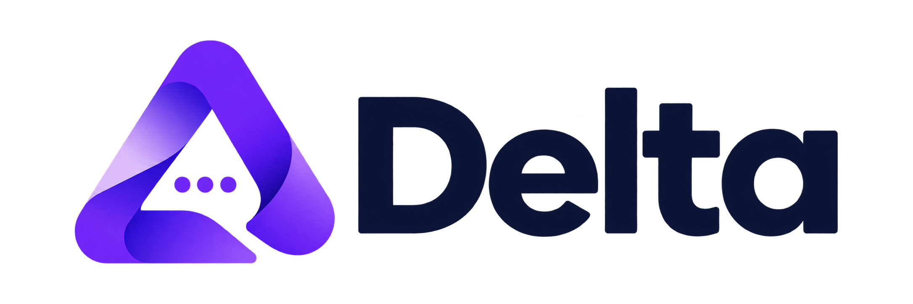

# Delta — Everything connects.

<div align="center">
  
  <p><strong>A high-performance modern messaging platform built for speed, privacy, and seamless cross-platform communication.</strong></p>
  <p>Competes with WhatsApp Web and Telegram Web with an original design system, PostgreSQL Row Level Security, WebRTC calling, and PWA capabilities.</p>
</div>

---

## 🌟 Key Product Features

### 1. Core Messaging
- **Direct & Group Conversations:** 1-on-1 private messaging and multi-member groups with administrator and moderator roles.
- **Persistent PostgreSQL Storage:** Schema includes `profiles`, `conversations`, `conversation_members`, `messages`, `message_receipts`, `message_reactions`, `message_attachments`, `polls`, `statuses`, `communities`, `channels`, and `call_sessions`.
- **Database-Backed Delivery Semantics:** Real Sent (`single check`), Delivered (`double grey check`), and Read (`double indigo check`) states.
- **Optimistic Updates & Rollback:** Instant UI updates with spinners and graceful retry behavior on failure.
- **Rich Message Media:** Text, documents/PDFs, image attachments, waveforms for voice notes, and interactive polls.
- **Real-Time Presence & Typing:** WebSockets broadcast for live typing indicators and privacy-respecting online / last-seen states.
- **Conversational Actions:** Reply to specific messages, emoji reactions, edit own messages, soft-delete, forward, pin, and mute conversations.

### 2. Advanced Communication
- **Delta Status (24-Hour Stories):** Ephemeral text and photo updates with 24-hour expiration, customizable backgrounds, progress viewer, and view receipts.
- **WebRTC Peer-to-Peer Calling:** 1-on-1 Audio and Video calling with live duration timer, camera toggles, microphone mute, and STUN/TURN signaling.
- **Interactive Live Polls:** Create single or multi-choice polls, cast votes, and observe real-time animated percentage bars.
- **Communities & Channels:** Verified public/team broadcast feeds with subscriber tracking and nested organization groups.
- **Progressive Web App (PWA):** Installable application shell with `manifest.json` and responsive layouts for desktop, tablet, and mobile.

### 3. Design System & Aesthetics
- **Warm Off-White Light Interface:** Warm surfaces (`#FAFAF7`), pure white cards (`#FFFFFF`), dark charcoal text (`#0F172A`), and refined indigo accents (`#4F46E5`).
- **Carefully Designed Dark Mode:** Deep obsidian surfaces (`#0F1319`), slate panels (`#181F2A`), and high-contrast text.
- **Three-Panel Desktop Layout:** Vertical navigation rail, searchable conversation list, and interactive conversation workspace with collapsible details drawer.
- **Original Vector Brand:** Geometric Greek letter Delta (Δ) with interconnected nodes embodying *"Everything connects"*.

---

## 🚀 Quick Start Guide

### Prerequisites
- Node.js 18+ (tested on Node.js v24.12.0)
- npm 9+

### 1. Install Dependencies
```bash
npm install
```

### 2. Start Development Server
```bash
npm run dev
```
Open [http://localhost:3000](http://localhost:3000) in your browser. Delta starts immediately in **Interactive Demo Mode** with pre-seeded personas (Aarav, Priya, Arjun, Rohit).

### 3. Build & Run Production Bundle
```bash
npm run build
npm run start
```

---

## ⚙️ Connecting to Live Supabase Backend

Delta includes an automatic environment detector. To switch from local demo mode to live Supabase PostgreSQL and Authentication:

1. Create a project at [supabase.com](https://supabase.com).
2. Copy `.env.example` to `.env.local`:
   ```bash
   cp .env.example .env.local
   ```
3. Populate your Supabase credentials:
   ```env
   NEXT_PUBLIC_SUPABASE_URL=https://your-project-ref.supabase.co
   NEXT_PUBLIC_SUPABASE_ANON_KEY=eyJhbGciOi...
   SUPABASE_SERVICE_ROLE_KEY=eyJhbGciOi...
   NEXT_PUBLIC_ENABLE_DEMO_MODE=false
   ```
4. Execute SQL migrations in your Supabase SQL Editor in numerical order:
   - `supabase/migrations/20261027000001_initial_schema.sql` (Tables & Triggers)
   - `supabase/migrations/20261027000002_rls_policies.sql` (Row Level Security)
   - `supabase/migrations/20261027000003_storage_buckets.sql` (Storage Buckets)
   - `supabase/migrations/20261027000004_realtime_setup.sql` (Realtime Publication)

---

## 🧪 Testing Suite

### Unit Tests (Vitest)
Unit tests verify business rules, privacy controls, file formatting, and authorization logic:
```bash
npm test
```
*Result: 9/9 tests passed.*

### End-to-End Tests (Playwright)
Playwright browser tests verify workspace rendering, optimistic message delivery, WebRTC calling modal, and DevOps settings:
```bash
npx playwright test
```
*Result: 4/4 tests passed.*

---

## 🔒 Security & Row Level Isolation

- **Kernel-Level Access Control:** Database queries strictly check `public.is_conversation_member(conv_id)`. Non-members cannot select, insert, or update messages or attachments.
- **Private Storage Buckets:** Private buckets for attachments and media with signed URLs.
- **Service Role Protection:** Service role keys are never bundled in client code.

---

## 📁 Repository Structure

```
DELTA/
├── docs/
│   ├── ARCHITECTURE.md          # Data flow, Realtime, trust boundaries, E2EE
│   ├── FEATURE_STATUS.md        # Feature completion and verification status
│   └── PRODUCTION_READINESS.md  # Security audit, indexing, and deployment guide
├── public/
│   ├── delta-logo.svg           # Original vector geometric logo
│   └── manifest.json            # PWA web manifest
├── src/
│   ├── __tests__/               # Vitest unit test suite
│   ├── app/                     # Next.js App Router (page, auth, not-found, error)
│   ├── components/
│   │   ├── brand/               # DeltaLogo brand mark
│   │   ├── channels/            # Channels broadcast feed
│   │   ├── chat/                # ChatArea, VoiceNotePlayer
│   │   ├── communities/         # Communities directory
│   │   ├── layout/              # NavigationRail, ConversationList, Details
│   │   ├── modals/              # CallModal, SettingsModal, NewChat, StatusViewer
│   │   └── status/              # Delta Status 24h stories
│   ├── context/                 # AuthContext & MessagingContext
│   ├── data/                    # Realistic mock data and test personas
│   ├── lib/                     # Supabase client/server & utility helpers
│   └── types/                   # Domain TypeScript definitions
├── supabase/
│   └── migrations/              # Version-controlled SQL migrations
├── tests/                       # Playwright E2E browser tests
├── playwright.config.ts         # Playwright test runner configuration
├── tailwind.config.ts           # Delta warm/dark design tokens
└── vitest.config.ts             # Unit test runner configuration
```
