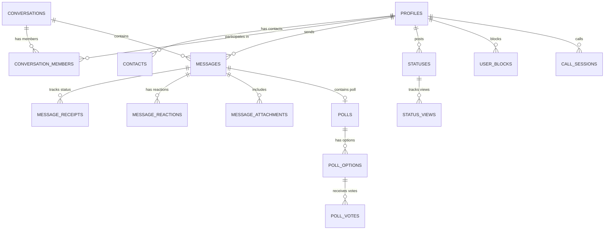

# Delta Architecture & Security Specifications

## 1. System Overview

Delta is a high-performance, privacy-focused modern messaging platform designed to challenge WhatsApp Web and Telegram. It utilizes a unified Next.js App Router architecture with Supabase (PostgreSQL, Auth, Realtime, Storage) as the primary backend, combined with WebRTC peer-to-peer signaling for voice and video communication.

```mermaid
graph TD
  Client[Next.js PWA Client] -->|HTTPS & RLS| Postgres[(Supabase PostgreSQL 15+)]
  Client -->|WebSockets (WSS)| Realtime[Supabase Realtime Channel]
  Client -->|Signed URLs / Upload| Storage[Supabase Storage Buckets]
  Client <-->|WebRTC P2P Data / Audio / Video| Peer[Remote Peer Client]
  Client -.->|STUN / TURN NAT Traversal| StunTurn[Google STUN / Coturn]
```

---

## 2. Trust Boundaries & Row Level Security (RLS)

Security in Delta is enforced at the database kernel level through PostgreSQL Row Level Security (RLS). A user client is never trusted implicitly:

### A. Conversation Membership Boundary
Every access to `conversations`, `messages`, `message_receipts`, `message_reactions`, `message_attachments`, and `polls` is checked via:
```sql
create or replace function public.is_conversation_member(conv_id uuid)
returns boolean as $$
begin
  return exists (
    select 1 from public.conversation_members
    where conversation_id = conv_id
      and user_id = auth.uid()
  );
end;
$$ language plpgsql security definer;
```
Non-members cannot read message bodies, retrieve attachments, or enumerate conversation participants simply by knowing or guessing UUIDs.

### B. Message Modification and Deletion Boundary
- Only the original `sender_id` (matched to `auth.uid()`) can modify their own message (`is_edited = true`).
- Only the sender or an authorized conversation administrator can delete a message.

### C. Contact & Block Boundary
Blocks are enforced in the database via `user_blocks` and `is_user_blocked()` function. Blocked users cannot query profiles, initiate call sessions, or view status updates.

---

## 3. Realtime Subscription Lifecycle

Delta utilizes Supabase Realtime (powered by Phoenix Channels / WebSockets) to deliver events with sub-50ms latency:

1. **Connection Initialization:** Upon client mount, the client opens a websocket connection to Supabase Realtime using the authenticated JWT.
2. **Channel Topics:**
   - `conversation:{conversationId}`: Broadcasts typing indicators, new messages, receipts, and reactions.
   - `user:{userId}`: Delivers incoming call offers, direct message notifications, and contact requests.
   - `status:broadcast`: Delivers ephemeral status view counts and updates.
3. **Optimistic Updates & Deduplication:** When a message is dispatched:
   - The message is assigned a temporary optimistic ID (`msg-opt-*`) and appended to UI state immediately.
   - The message status shows a spinner.
   - When the database write succeeds or Realtime broadcast arrives with the persisted UUID, the optimistic message is merged and transitioned to `sent` or `delivered` state.

---

## 4. WebRTC Audio & Video Calling Architecture

### A. Signaling Flow
1. **Offer Generation:** The caller creates an SDP Offer via `RTCPeerConnection.createOffer()` and writes to `call_sessions` table (status: `offering`).
2. **Notification & Ringing:** The callee listens on their private realtime channel or polling subscription, receives the offer, updates status to `ringing`, and prompts the user.
3. **Answer Generation:** Upon answer, callee sets remote description, creates an SDP Answer via `createAnswer()`, and writes it to `call_sessions` (status: `connected`).
4. **ICE Candidate Exchange:** ICE candidates are exchanged incrementally through websocket signaling payloads.
5. **Media Stream:** Audio/video media tracks flow directly peer-to-peer using SRTP (Secure Real-time Transport Protocol).

### B. NAT Traversal & STUN/TURN Infrastructure
- Default configuration uses Google public STUN servers: `stun:stun.l.google.com:19302`.
- Behind strict symmetric NATs or enterprise firewalls, a configured TURN server (such as Coturn) relays encrypted traffic. Credentials are configurable in environment variables:
  `TURN_SERVER_URL`, `TURN_USERNAME`, `TURN_CREDENTIAL`.

---

## 5. End-to-End Encryption (E2EE) Analysis & Status

Delta does not claim false end-to-end encryption. All communications are protected in transit via TLS 1.3 and at rest in PostgreSQL with strict Row Level Security.

### Production E2EE Roadmap:
For complete end-to-end encryption equivalent to the Signal Protocol:
- **Key Agreement:** Extended Triple Diffie-Hellman (X3DH) using Curve25519.
- **Session Ratchet:** Double Ratchet Algorithm with pre-keys stored in Supabase.
- **Storage:** Ciphertext only (`encrypted_payload`) stored in database; server cannot decrypt.
- **Group Ratchet:** Sender Keys protocol for efficient group fanout.
- **Status:** Architecture designed; planned for milestone 2. Current production MVP relies on transport security + database RLS isolation.

---

## 6. Database ER Diagram


